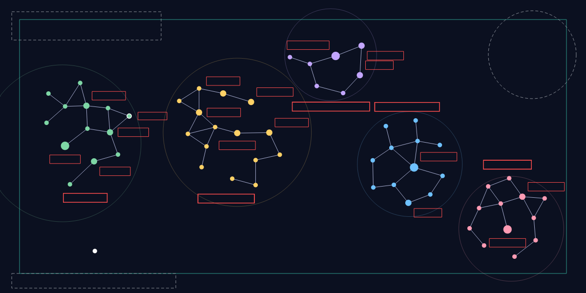

<div align="center">



<br><br>

# git-constellation

*Every repo is a star. Every language is a constellation.*<br>
*Every commit makes the sky a little brighter.*

<sub>A Rust CLI that draws your GitHub profile as a night sky. Work in progress, and honest about it.</sub>

</div>

<br>


<br>

I wanted my first Rust project to be cute. Not a todo app, not a tool that renames files. Something you'd actually want to put at the top of your profile.

Then I found [git-koi](https://github.com/yalongwastaken/git-koi), a little pixel koi that swims around a GitHub README, and I couldn't stop thinking about it. Same energy, I decided, different animal.

My first try was a garden, with every repo as a plant. It looked like clip art, so I deleted it.

Then I looked up. A night sky is already a data visualization. Stars have brightness and colour, constellations group things together, and the Milky Way is literally a band of density. A GitHub profile is the same thing: a pile of repos, some bright, some dusty, a few you forgot about. So that's the project.

**What it does** (or will do, see [where things stand](#where-things-stand)):

- Each public repo becomes a **star**. Louder repos shine bigger, and the colour comes from the main language.
- Repos in the same language get joined into a **constellation**, with a name like *The Little Crab* or *The Gentle Serpent*.
- Your last year of commits becomes the **Milky Way**, brighter in the weeks you were busy.
- A **moon with a face** keeps track of your streak. It falls asleep when you do.
- Everything is seeded from your username, so your sky is yours, and rendering the same data twice gives you the exact same file.

<br>

<div align="center">

</div>

<br>

<div align="center">

</div>

<br>

A star's size comes from one small formula:

```
score = ln(1 + stars) + 0.6 × ln(1 + commits_last_year) + recency_bonus
```

Stars matter most, commits count for a bit less, and a repo you pushed to this week gets a little boost. I take the logarithm so one repo with 3,000 stars doesn't flatten everything else into dust.

There's also a rule I added after looking at my own test data: **only about 8% of stars can be the biggest size, and about 20% the next one down.** Without that cap, half the sky came out as flagship stars with big flares, and a sky where everything is special is a boring sky.

<details>
<summary>The same legend as plain text, if you can't see the picture</summary>

<br>

| In the sky | What it means |
|---|---|
| Star size, tier 1 to 5 | How loud the repo is (formula above) |
| Star colour | Main language: Rust peach, Python blue, JS/TS yellow, Go mint, Java coral, C/C++ lavender, HTML/CSS pink, Shell lime, Jupyter cyan, everything else white |
| Constellation | A group of repos sharing a language, joined by thin lines |
| Milky Way | Your last 365 days of contributions, 53 weekly slices |
| Moon phase | Current streak: new at 0 days, crescent at 1 to 3, half at 4 to 9, gibbous at 10 to 29, full at 30+ |
| Moon's face | Active days in the last week: sleepy, content, happy, delighted |
| Shooting star | A pull request merged in the last 30 days (up to six) |
| Pulsing ring | A repo pushed to in the last day or two |
| Dim, dashed star | A repo with no pushes in 180+ days, or an archived one |
| Tiny orbiting dot | A fork (up to three per bright star) |
| Ringed star | Your oldest original repo, "first light" |

</details>

<br>

<div align="center">

</div>

<br>

<div align="center">

</div>

<br>

The pipeline is deliberately boring. **Rules** decide *what* exists, **layout** decides *where* it goes, and **art** decides *how it looks*. None of them know what the others are doing. That separation is what let me test the layout engine properly before writing a single line of drawing code.

Constellations are the fun part. A real one looks like a stick figure, not a scatter plot, so the layout is built to produce that:

<details>
<summary>How a constellation gets its shape</summary>

<br>

1. **Anchors.** Each constellation gets a home, placed using a Halton sequence (a low-discrepancy sequence, which spreads points out more evenly than plain random). Anything that crowds a neighbour is rejected. The brightest group is steered toward the middle-left, where your eye lands first.
2. **A growing walk.** Stars are placed one at a time. Each new star turns by a random angle from its parent, then I generate 40 candidates and keep the one that stays *furthest* from every existing star. That one rule is what stops clumping.
3. **Relaxation.** 30 rounds of gentle spring repulsion even out whatever is left.
4. **Lines.** A minimum spanning tree (Prim's algorithm) joins each group. Then a few extra edges are added, but only if they cross nothing and don't make a sliver-thin angle. Lines never cross. That is a hard rule, and a test checks it.
5. **Labels.** For each label I score eight candidate spots against stars, lines, other labels and the edges, and take the cleanest. If nothing fits, the label is dropped. A missing label is better than a label on top of a star.

All the randomness comes from a ChaCha8 generator seeded with a hand-written hash of your username. I wrote the hash myself because Rust's built-in one is allowed to change between versions, which would quietly change everyone's sky.

</details>

<details>
<summary>The "sky linter", a test suite for taste</summary>

<br>

Generated art drifts toward ugly without anybody noticing, so the project grades its own pictures. A linter runs on six fake accounts (from completely empty to 150 repos) and **fails the build** if it finds:

- stars closer together than their glows allow
- a label overlapping a star, a line, another label, or the margin
- crossing constellation lines
- a constellation name that sits closer to its neighbour than to its own stars
- a lopsided composition, or any NaN hiding in the coordinates

It also prints softer warnings, with numbers: how much of the canvas is covered, the biggest empty gap, and (once there's art) how bright the rendered picture is.

</details>

<br>

<a id="where-things-stand"></a>

<div align="center">

</div>

<br>

<div align="center">

</div>

<br>

Three milestones are done: the project scaffold with CI, the data model with every sky rule, and the layout engine with the linter. Milestone four, the actual background art, is next.

So right now the project can decide where every star goes, but it can't draw one yet. Here is what "working" looks like at this stage, a wireframe from a fake account with 150 repos, trimmed to its brightest 60:

<div align="center">



<sub>Ugly on purpose. Five constellations, 60 stars, zero crossing lines, zero overlapping labels.<br>The glow, the nebula and the Milky Way come next.</sub>

</div>

<br>

<div align="center">

</div>

<br>

> None of these commands exist yet. This is the interface I'm building toward.

```bash
constel render your-username --out sky.svg          # draw your sky
constel timelapse your-username --out year.gif      # watch a year of your sky form
constel card your-username --out card.png           # a share card for socials
constel stats your-username                         # a cosy terminal readout
constel explain your-username/your-best-repo        # why does this star look like that?
constel preview --from-file activity.json           # tweak things and watch it update live
```

The last two are my favourite ideas. `explain` will tell you exactly why a star looks the way it does: the score breakdown, the tier, why it's that colour, which constellation it belongs to. Nothing in the sky should be a mystery.

To put it on your profile, there'll be a nightly GitHub Action that regenerates the sky and commits it. The embed switches between a night sky and a paper sky depending on whether the reader uses dark or light mode:

```html
<picture>
  <source media="(prefers-color-scheme: dark)"  srcset="constellation/sky-dark.svg">
  <source media="(prefers-color-scheme: light)" srcset="constellation/sky-light.svg">
  
</picture>
```

The output is one self-contained SVG: CSS and SMIL animation only, no scripts, no external fonts, no external images. That's the only way it survives being shown inside a normal image tag on GitHub.

<br>

<div align="center">

</div>

<br>

<div align="center">

</div>

<br>

`midnight` is the default. `paper` is the one I'm most curious about: it's the light-mode sky, drawn like ink and watercolour on cream paper instead of glowing on dark. `mono` is for people who don't want any colour at all, no judgement.

<br>

<div align="center">

</div>

<br>

Things I haven't solved yet, in no particular order:

- **Is the brightness fair?** A repo with 400 commits and no stars versus a repo with 15 stars and three commits. The formula says they're about equal. I'm not sure my gut agrees.
- **Busy skies.** With 150 repos, labels get dropped to avoid overlaps. I can prove nothing overlaps. I can't yet prove it still *feels* good.
- **GIF size.** The timelapse of your year could easily be five megabytes. GitHub will happily show that, but nobody will want to load it.
- **Paper theme.** It exists on paper (sorry) and in a colour table. I haven't seen it rendered yet, so I'm not going to pretend it works.
- **Cute without being childish.** The moon has a face. The stars might get faces. I'm still deciding where the line is.

If you've got opinions about any of these, or a really good constellation name, open an issue. I'd love to hear it.

<br>

<div align="center">


<br>

<sub>Inspired by <a href="https://github.com/yalongwastaken/git-koi">git-koi</a>. Public data only. MIT licensed.</sub>

</div>
